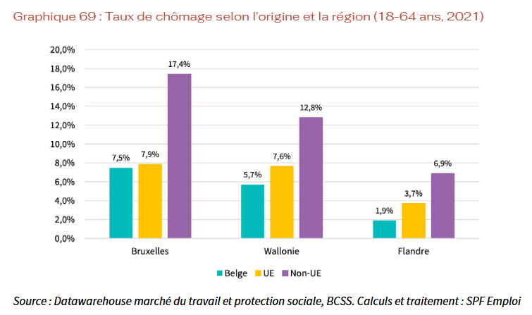
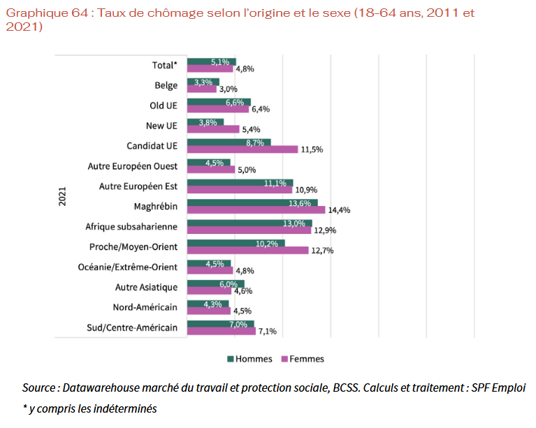
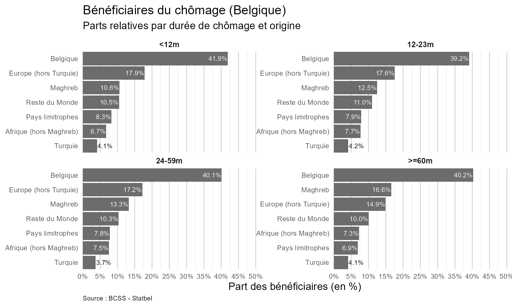
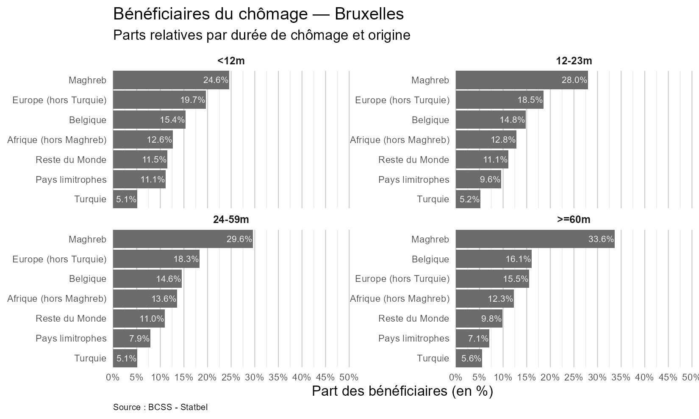
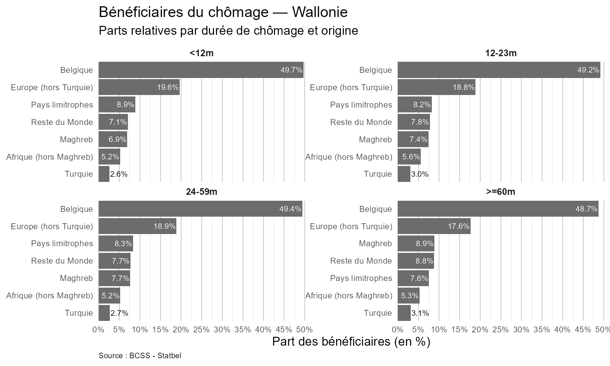
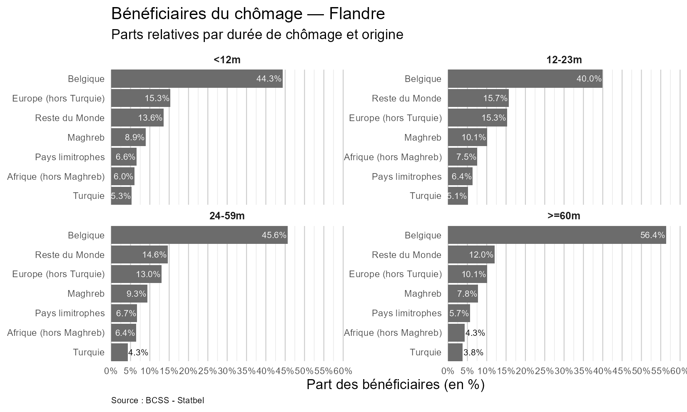

À la suite d’une question parlementaire de Sophie Thémont (PS) sur l’impact potentiel de la limitation dans le temps des allocations de chômage pour les publics exposés à la discrimination, le ministre de l’Emploi David Clarinval (MR) s’est fendu d’une réponse en presse (Sud Presse) et en radio (Bel RTL) : 57 % des personnes exclues seraient non-belges.

Cette assertion a été largement contestée par plusieurs décryptages[^1]. Mais surtout, autant la réponse médiatique que la réponse parlementaire[^2] évitent le fond de la question posée : la fin de droit pour plus de 190 000 personnes va-t-elle frapper davantage des groupes déjà défavorisés sur le marché du travail ?

En Belgique comme ailleurs, les discriminations documentées touchent plusieurs dimensions : notamment l’âge, le genre, l’origine, le handicap, mais aussi leur cumul. Dans cette note, je me concentre délibérément sur l’origine, l’angle retenu par le ministre dans sa communication. L’objectif n’est pas tant d’alimenter un duel de chiffres, mais de faire ce que le ministre aurait dû faire plutôt que mentir : esquisser un début de réponse honnête à la problématique soulevée.

## Chômage et discriminations raciales

Plutôt que d’écrire dans sa réponse parlementaire que l’ONEM ne dispose pas des chiffres et de s’aventurer dans une hasardeuse règle de trois, le ministre aurait pu consulter le “*Rapport Diversité 2024*“ du SPF Emploi[^3] sous sa tutelle. On y découvre ce qu’on sait très bien depuis plusieurs années : oui, la Belgique a un problème de discrimination raciale sur son marché du travail. Le taux de chômage des personnes qui ne sont pas de nationalité belge ou qui ont une ascendance étrangère (ci-après *“d’origine étrangère”)* est plus élevé que celui des belgo-belges. La Belgique est même l’un des pires élèves en Europe en la matière[^4].

Le Rapport de l’ONEM complète cette image en présentant des chiffres pour le taux de chômage selon les origines dans diverses dimensions.

**Origine et régions.** Bruxelles et la Wallonie affichent des taux de chômage supérieurs à la Flandre. En croisant région et origine, on constate que, dans ces deux régions, le taux de chômage des personnes d’origine hors UE est environ 2,3 fois celui des belgo-belges. En Flandre, le ratio est d’environ 3,6 fois.

{fig-alt="Taux de chômage selon l’origine et la région (18-64 ans, 2021), à Bruxelles, en Wallonie et en Flandre, pour les personnes d’origine belge, UE et non-UE"}

**Origine et genre.** Le taux de chômage des personnes d’origine non belge est supérieur à celui des personnes d’origine belge, chez les hommes et chez les femmes. Pour la plupart des origines, les femmes sont davantage au chômage que les hommes. La dimension de genre aggrave particulièrement la situation du chômage pour le groupe “Candidat UE” (comprenant les personnes d’origine turque).

{fig-alt="Taux de chômage selon l’origine et le sexe (18-64 ans, 2011 et 2021)"}

**Origine et niveau d’éducation.** Le chômage recule à mesure que le niveau de diplôme augmente, toutes origines confondues. À diplôme égal, les personnes d’origine belge restent le plus souvent les moins exposées. Surtout, le diplôme réduit les écarts liés à l’origine sans les effacer : ils sont plus marqués aux faibles niveaux de qualification et se resserrent parmi les diplômé·es du supérieur.

**Origine et âge.** Le Rapport note que la situation des personnes plus âgées est plus préoccupante : “*Le taux de chômage des 55-64 ans est élevé pour toutes les origines, surtout pour les personnes originaires du Maghreb (24,7%) et d’un pays candidat à l’UE (22,7%), mais il a fortement diminué pour ces deux origines depuis 2011. Bien que le taux de chômage des 45-54 ans soit le plus bas pour les Belges d’origine (2,4%), il dépasse les 10% pour plusieurs origines, dont les personnes originaires du Maghreb, d’Afrique subsaharienne ou encore du Proche/Moyen-Orient.”*

Tout ceci suggère que oui, on a un problème en général en Belgique avec les discriminations raciales sur le marché de l’emploi et que ceci est une couche supplémentaire ajoutée aux autres discriminations observées (genre, âge, ...).

## Origine et durée de chômage

Admettons que le ministre et son cabinet n’aient pas pensé à utiliser un moteur de recherche pour répondre à la question parlementaire. Avec les données qu’il mobilise, il aurait pu se demander : **comment évolue la composition en terme d’origine des bénéficiaires** du chômage selon la durée d’indemnisation ? Il existe des arguments de droite comme de gauche pour poser une hypothèse de présence accrue des groupes d’origine étrangère dans les chômeurs de longue durée. Analysons les chiffres.

Le graphique suivant présente les bénéficiaires du chômage en Belgique, ventilés par durée d’indemnisation (fin 2023). La part des belgo-belges est stable quelle que soit la durée : 42 % pour le chômage de courte durée (\< 12 mois) contre 40,2 % pour la très longue durée (≥ 60 mois). Du côté des groupes d’origine étrangères, deux évolutions seulement sont marquantes : la part des personnes d’origine maghrébine (nationalité belge ou non) passe de 10,6 % à 16,6 % entre le chômage court et le très long, tandis que l’Europe (hors Turquie et pays limitrophes) recule de 17,9 % à 14,9 %.

{fig-alt="Bénéficiaires du chômage en Belgique : parts relatives par durée de chômage et origine"}

Ces dynamiques sur le pays cachent évidemment des spécificités au niveau des Régions belges.

**Bruxelles.** Les personnes d’origine du Maghreb est le premier groupe de bénéficiaires du chômage, peu importe la durée (ce qui semble logique vu la composition démographique de la Région). Ce qui est notable, c’est que la part de bénéficiaires de cette origine progresse nettement avec la durée d’indemnisation : de 24,6 % des bénéficiaires pour le chômage de courte durée à un tiers pour le chômage de très longue durée (33,6 %). La part des bénéficiaires belgo-belge reste basse et quasi stable (≈15–16 %).

{fig-alt="Bénéficiaires du chômage à Bruxelles : parts relatives par durée de chômage et origine"}

**Wallonie.** Le profil est proche de la moyenne nationale et très stable dans le temps. La présence de belgo-belges tourne autour de la moitié des bénéficiaires quelle que soit la durée d’indemnisation (≈49–48 %). La part de bénéficiaires d’Europe (hors Turquie et pays limitrophes) fléchit légèrement à mesure que la durée s’allonge. La part du Maghreb et du “reste du monde” progressent lentement avec la durée d’indemnisation.

{fig-alt="Bénéficiaires du chômage en Wallonie : parts relatives par durée de chômage et origine"}

**Flandre.** La trajectoire est inverse de Bruxelles : plus la durée d’indemnisation augmente, plus la part des bénéficiaires belgo-belges s’élève (de 44,3 % à 56,4 % au-delà de 5 ans). La part des groupes d’origine étrangère diminuent avec la durée, notamment l’Europe hors Turquie et, dans une moindre mesure, le Maghreb.

{fig-alt="Bénéficiaires du chômage en Flandre : parts relatives par durée de chômage et origine"}

Ces quelques éléments statistiques descriptifs ne sont rien par rapport à une véritable analyse quantitative sur l’impact des discriminations. Disons que tout ceci aurait pu être une réponse du ministre à la députée Thémont en lui promettant de revenir avec un plan plus solide pour répondre au fond du problème.

[^1]: [“57% des exclus du chômage ne sont pas Belges” : le chiffre est faux, c’est 19% (Faky RTBF)](https://www.rtbf.be/article/57-des-exclus-du-chomage-ne-sont-pas-belges-le-chiffre-est-faux-c-est-19-11624204)

[^2]: [Réponse à la question parlementaire écrite n° 265 (David Clarinval)](https://clarinval.belgium.be/fr/question-parlementaire-ecrite-ndeg-265)

[^3]: [Rapport Diversité 2024 (SPF Emploi, Travail et Concertation Sociale)](https://emploi.belgique.be/sites/default/files/content/publications/FR/RapportDiversite2024.pdf)

[^4]: [Les chiffres d’Eurostat sous forme de graphique sont disponibles ici](https://public.flourish.studio/visualisation/25986168/).
